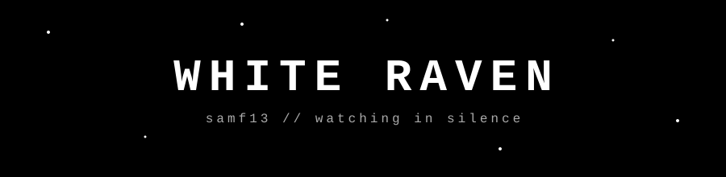

# samf13

<div align="center">




<br/><br/>


</div>


## 🪶 The White Raven

```text
> whoami
samf13, the White Raven

> cat legend.txt
A white raven is rare, unusual, and impossible to ignore.
I build things that stand out in a flock of black.

> status
[■■■■■■■■□□] 80% caffeinated
```

## 🛠️ White Raven's Toolkit

<div align="center">


</div>

## 📊 White Raven Stats

<div align="center">


</div>

## 🐍 The White Raven Eats Contributions

<div align="center">


</div>

## 🌑 White Raven Flight Log

<div align="center">


</div>

## 📫 Find the White Raven

<div align="center">

[](https://github.com/samf13)


</div>